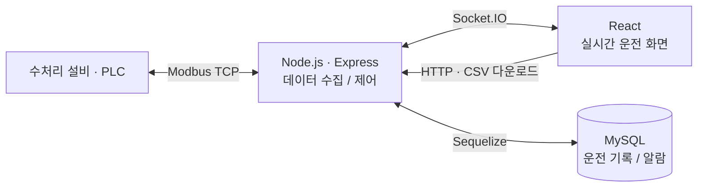

# Water Treatment SCADA

수처리 설비의 상태를 웹에서 실시간으로 확인하고, 운전 데이터와 알람 이력을 관리하는 모니터링·제어 프로젝트입니다. PLC와 웹 애플리케이션을 연결해 현장 데이터를 운영 화면으로 전달합니다.

**공동 프로젝트:** [손언상 · fortex66](https://github.com/fortex66) × [seonghyeon0312](https://github.com/seonghyeon0312)  
이 저장소는 공동 작업 원본인 [RealTime-monitoring](https://github.com/seonghyeon0312/RealTime-monitoring)을 포크해, 원본 코드와 커밋 이력을 이어받았습니다.

## 시스템 구성



| 영역 | 주요 기능 |
| --- | --- |
| 실시간 모니터링 | 공정·입출력·설비 상태 표시, 화면별 데이터 갱신 |
| 설비 제어 | PLC 레지스터·코일 쓰기, 펌프·구동 장치 조작 화면 |
| 기록과 분석 | 알람 관리, 기간별 이력·그래프 조회, CSV 다운로드 |

**기술:** React · Chart.js · Node.js · Express · Socket.IO · Modbus TCP · MySQL · Sequelize

## 로컬 실행

Node.js/npm, MySQL, 연결 가능한 PLC 또는 호환 Modbus TCP 환경이 필요합니다. 설비 주소와 데이터 매핑, DB 초기 데이터는 실행 환경에 맞게 설정해야 합니다.

1. `backend/.env`에 DB 연결 정보를 설정합니다.

   ```dotenv
   MYSQL_DATABASE=water_scada
   MYSQL_USERNAME=your_user
   MYSQL_PASSWORD=your_password
   MYSQL_HOST=localhost
   MYSQL_PORT=3306
   PORT=8001
   ```

2. [Modbus 연결 설정](backend/config/modbusConfig.js)을 실행 환경에 맞게 조정하고, 프런트엔드의 Socket.IO·HTTP 서버 주소를 확인합니다. DB 모델과 초기화 코드는 [backend/model](backend/model)과 [backend/config/init.js](backend/config/init.js)에 있습니다. 초기 사용자·설비 데이터 생성 예시는 현재 주석 처리되어 있습니다.

3. 터미널 두 개에서 각각 실행합니다.

   ```sh
   cd backend
   npm ci
   npm start
   ```

   ```sh
   cd frontend
   npm ci
   npm start
   ```

프런트엔드 개발 서버는 기본 `http://localhost:3000`, 백엔드는 기본 `8001` 포트를 사용합니다. 현재 백엔드의 정적 화면 배포 코드는 주석 처리되어 있으며, 프런트엔드 빌드 스크립트는 Windows 명령 문법을 사용합니다.

## 코드 탐색

- [backend/web.js](backend/web.js): HTTP API, 실시간 데이터 요청 및 제어 이벤트
- [backend/controller](backend/controller): PLC 데이터 읽기·쓰기와 기록 처리
- [frontend/src/pages](frontend/src/pages): 모니터링, 알람, 이력·그래프 화면
- [frontend/src/components](frontend/src/components): 설비 다이어그램과 조작 모달
